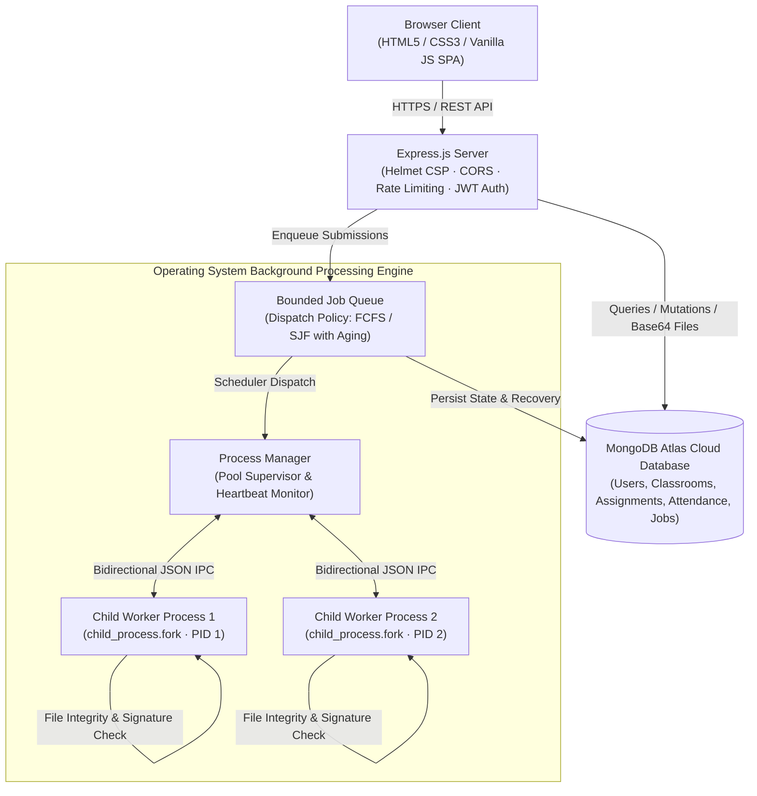
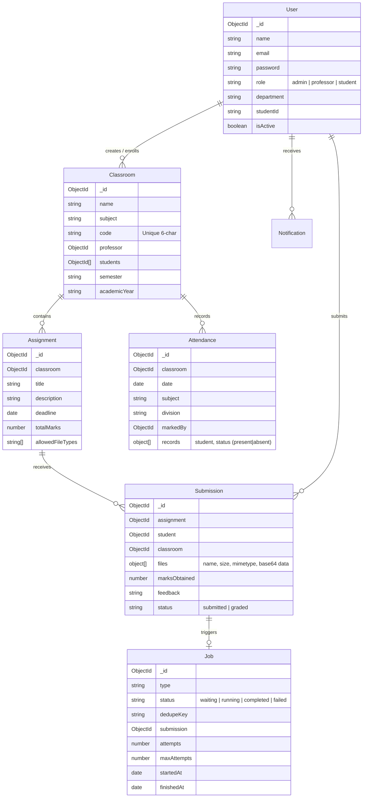

# 🎓 Academia ERP System

[](https://academia-erp-e7l0.onrender.com)
[-brightgreen?style=for-the-badge&logo=node.js)](https://github.com/sarveshmali025/academia-erp)
[](https://nodejs.org/)
[](https://www.mongodb.com/atlas)
[](https://github.com/sarveshmali025/academia-erp)

> **Academia ERP** is a full-stack, enterprise-grade College Academic Management System engineered with **Node.js, Express, MongoDB Atlas, and modern vanilla JavaScript**. In addition to classroom, assignment, attendance, and performance management, the backend integrates genuine **Operating System mechanisms**—including child process multiprocessing via `child_process.fork()`, bidirectional Inter-Process Communication (IPC), bounded job queuing, CPU scheduling algorithms (FCFS, non-preemptive SJF with aging), worker crash recovery, and state persistence.

🔗 **Live Deployment:** [https://academia-erp-e7l0.onrender.com](https://academia-erp-e7l0.onrender.com)  
📦 **GitHub Repository:** [https://github.com/sarveshmali025/academia-erp](https://github.com/sarveshmali025/academia-erp)

---

## 📑 Table of Contents

- [Overview & Problem Statement](#-overview--problem-statement)
- [System Architecture](#-system-architecture)
- [Key Modules & Features](#-key-modules--features)
  - [1. Role-Based Access Control (Admin, Professor, Student)](#1-role-based-access-control-admin-professor-student)
  - [2. Classroom & Student Management](#2-classroom--student-management)
  - [3. Assignment Creation, Submission & Grading](#3-assignment-creation-submission--grading)
  - [4. Attendance Management System & 75% Calculator](#4-attendance-management-system--75-calculator)
  - [5. Academic Performance Analytics & What-If Simulator](#5-academic-performance-analytics--what-if-simulator)
  - [6. Smart Assignment Deadline Manager & Reminders](#6-smart-assignment-deadline-manager--reminders)
- [Operating System Concepts Implemented](#-operating-system-concepts-implemented)
  - [Process Creation (`child_process.fork`)](#1-process-creation-child_processfork)
  - [Inter-Process Communication (IPC)](#2-inter-process-communication-ipc)
  - [Job Scheduling Algorithms (FCFS, SJF with Aging)](#3-job-scheduling-algorithms)
  - [Bounded Queue & Concurrency Management](#4-bounded-queue--concurrency-management)
  - [Fault Tolerance & Crash Recovery](#5-fault-tolerance--crash-recovery)
- [Technology Stack](#-technology-stack)
- [Database Schema & Data Models](#-database-schema--data-models)
- [Project Directory Structure](#-project-directory-structure)
- [REST API Reference](#-rest-api-reference)
- [Installation & Local Setup](#-installation--local-setup)
- [Environment Configuration](#-environment-configuration)
- [Testing & Quality Assurance](#-testing--quality-assurance)
- [Production Deployment (Render)](#-production-deployment-render)
- [Security & Hardening](#-security--hardening)

---

## 💡 Overview & Problem Statement

Modern higher-education institutions face significant challenges managing distributed course workflows, tracking student attendance compliance, evaluating submissions safely, and providing actionable academic insights:
1. **Scattered Workflows:** Attendance, submissions, and grades are frequently handled across disparate tools or manual spreadsheets.
2. **Attendance Policy Compliance:** Enforcing university criteria (e.g., minimum 75% attendance) requires proactive warning systems rather than end-of-semester surprises.
3. **Submission Integrity & Processing Bottlenecks:** Evaluating multi-file student archives synchronously blocks the main application server, risking server starvation and denial of service.
4. **Student Performance Tracking:** Students lack tools to simulate future grades or identify subject-wise strengths and weaknesses before final evaluations.

**Academia ERP** addresses these challenges through a unified platform that combines academic workflows with a background OS worker pool to offload heavy file validation asynchronously.

---

## 🏗️ System Architecture

The application is deployed as a unified Web Service where the Express backend delivers both API services and client static assets. Asynchronous tasks are offloaded to an isolated OS process worker pool:



---

## 🌟 Key Modules & Features

### 1. Role-Based Access Control (Admin, Professor, Student)
- **Role Isolation:** Strict role validation (`admin`, `professor`, `student`) enforced at both route middleware and database query scopes.
- **Admin Capabilities:** Manage user statuses (active/deactive), oversee all classrooms, inspect global submission rates, seed default credentials, and monitor background tasks.
- **Professor Capabilities:** Create and manage classrooms, generate unique 6-character enrollment codes, publish assignments with strict deadline validation, conduct attendance sessions, and evaluate student submissions.
- **Student Capabilities:** Join classrooms via class code, upload submissions, monitor color-coded upcoming deadlines, review evaluated marks, track attendance percentage, and run What-If grade simulations.

---

### 2. Classroom & Student Management
- Dynamic 6-character alphanumeric class code generation for instant enrollment.
- Full classroom lifecycle (Create, Read, Update, Delete) with department, semester, and academic year mappings.
- Student roster management with professor-controlled student removal.

---

### 3. Assignment Creation, Submission & Grading
- **Assignment Builder:** Set title, rich instructions, maximum marks, deadline timestamp, and allowed file formats (PDF, DOCX, ZIP, code files, images).
- **Multi-File Uploads:** Memory-based upload handling using Multer (up to 5 files, 10MB each), converted to Base64 buffers stored safely in MongoDB.
- **Evaluation Pipeline:** Professors grade submissions with numerical scores and qualitative feedback; real-time notifications alert students immediately upon evaluation.
- **Export Capabilities:** Client-side grade report export to Excel via SheetJS.

---

### 4. Attendance Management System & 75% Calculator
A purpose-built attendance tracking module designed for institutional attendance policy enforcement:
- **Daily Session Management:** Professors record daily attendance with date, subject, division, and student present/absent statuses.
- **Duplicate Prevention:** Strict server-side verification rejects duplicate attendance sessions for the same subject, division, and date with a `409 Conflict`.
- **75% Attendance Eligibility Calculator:**
  $$\text{Attendance \%} = \left(\frac{\text{Attended Sessions}}{\text{Total Sessions}}\right) \times 100$$
  - Real-time calculation of sessions required to reach the mandatory 75% threshold.
  - Safe skip margin calculation when attendance is strictly above 75%.
- **Role Dashboards:**
  - **Professor View:** Take attendance, review classroom session logs, and view aggregate student percentages.
  - **Student View:** Visual progress bar, attended vs. total count, and threshold warning badges.
  - **Admin View:** Cross-department attendance summaries and classroom-level audit logs.

---

### 5. Academic Performance Analytics & What-If Simulator
A dedicated student analytical suite providing data-driven academic insights:
- **Overall Academic Performance:** Cumulative percentage calculation derived from obtained marks across evaluated assignments:
  $$\text{Overall \%} = \left(\frac{\sum \text{Marks Obtained}}{\sum \text{Max Marks}}\right) \times 100$$
- **Subject-Wise Strength & Weakness Analysis:**
  - Evaluates individual subject performance metrics.
  - Categorizes subjects into **Strong** ($\ge 70\%$) or **Weak** ($< 50\%$).
  - Built-in "Insufficient Data" threshold when a subject has fewer than 2 evaluated assignments.
- **Chronological Performance Trend Graph:** Interactive SVG timeline visualizing mark progressions and cumulative moving averages over time.
- **Assignment Progress Breakdown:** Clear partition of Total, Submitted, Pending, and Evaluated tasks.
- **Interactive What-If Grade Simulator:** Allows students to input target percentages and project necessary scores on upcoming assignments without altering database records.

---

### 6. Smart Assignment Deadline Manager & Reminders
- **Color-Coded Urgency Badging:**
  - 🔴 **Red:** Overdue / Due Today / Due Tomorrow ($\le 1$ day remaining)
  - 🟠 **Orange:** Approaching (2–3 days remaining)
  - 🟡 **Yellow:** Upcoming (4–5 days remaining)
  - 🟢 **Green:** Adequate Time (6–7 days remaining)
- **Timeframe Filtering:** Quick filters for *Today*, *Next 7 Days (Default)*, *Next 14 Days*, and *All*.
- **Overdue Management:** Overdue tasks remain prominently visible for 3 calendar days post-deadline, then cleanly collapse into an overdue counter dialog (records are permanently retained).
- **Submission Exclusion:** Submitted assignments are automatically removed from pending deadline queues.
- **Deduplicated In-App Notifications:** Automatic reminders generated 1 day prior and on the day of the deadline, backed by in-memory mutex locks (`activeReminderLocks`) to prevent duplicate notices during concurrent requests.
- **Background Scheduler:** Scheduled sweeps every 30 minutes in `server.js` paired with instant on-demand checks during dashboard access.

---

## ⚙️ Operating System Concepts Implemented

Beyond standard web application functionality, this project demonstrates direct implementation of core Computer Science and Operating Systems concepts in Node.js:

```
┌────────────────────────────────────────────────────────────────────────┐
│                        PARENT NODE.JS PROCESS                          │
│                                                                        │
│   ┌─────────────────────┐               ┌──────────────────────────┐   │
│   │ Express HTTP Server │ ──Enqueues──> │     Bounded Job Queue    │   │
│   └─────────────────────┘               │  (FCFS / SJF with Aging) │   │
│                                         └────────────┬─────────────┘   │
│                                                      │ Dispatch        │
│                                         ┌────────────▼─────────────┐   │
│                                         │     Process Manager      │   │
│                                         │   (Pool Supervisor)      │   │
│                                         └────────────┬─────────────┘   │
└──────────────────────────────────────────────────────┼─────────────────┘
                                                       │ IPC Channels
                                    ┌──────────────────┴──────────────────┐
                                    ▼                                     ▼
                     ┌──────────────────────────────┐      ┌──────────────────────────────┐
                     │     CHILD PROCESS (W-1)      │      │     CHILD PROCESS (W-2)      │
                     │    child_process.fork()      │      │    child_process.fork()      │
                     │  --------------------------  │      │  --------------------------  │
                     │  • SHA-256 Checksumming      │      │  • SHA-256 Checksumming      │
                     │  • File Magic Bytes Sniffing │      │  • File Magic Bytes Sniffing │
                     │  • Word / Line Count Engine  │      │  • Word / Line Count Engine  │
                     └──────────────────────────────┘      └──────────────────────────────┘
```

### 1. Process Creation (`child_process.fork`)
- Worker processes are spawned as independent OS processes via `child_process.fork('./workers/jobWorker.js')`.
- Each worker runs in an isolated V8 runtime with its own Process ID (PID) and memory space, shielding the primary HTTP server from CPU-intensive file inspection.

### 2. Inter-Process Communication (IPC)
Parent and child processes communicate strictly over Node.js IPC channels using structured JSON protocols:
- **Parent $\to$ Worker:** `{ type: 'job', jobId, attempt, payload }`, `{ type: 'ping' }`, `{ type: 'shutdown' }`
- **Worker $\to$ Parent:** `{ type: 'ready', pid }`, `{ type: 'progress', jobId, pct }`, `{ type: 'result', jobId, result }`, `{ type: 'error', jobId, error, retryable }`, `{ type: 'pong' }`

### 3. Job Scheduling Algorithms
The background engine implements real-world scheduling algorithms (`services/scheduler.js`):
- **First-Come-First-Served (FCFS):** Jobs are dispatched strictly according to arrival timestamp.
- **Shortest-Job-First (SJF) [Non-Preemptive]:** Burst times are estimated using total submission byte size; shorter files are prioritized to minimize Average Waiting Time ($W_{\text{avg}}$).
- **Starvation Prevention (Aging Mechanism):** To prevent large files from being starved indefinitely by incoming small files, jobs accumulate virtual priority as waiting time exceeds `JOB_SJF_AGING_MS` (default: 60,000 ms).
- **Scheduling Simulator:** An embedded analytical scheduler model capable of simulating and plotting FCFS, SJF, and Round Robin (RR) with configurable time quanta and idle gap modeling.

### 4. Bounded Queue & Concurrency Management
- **Capacity Limits:** Queue size is strictly bounded by `JOB_QUEUE_MAX` (default: 50).
- **Graceful Rejection:** When the queue reaches capacity, the student's submission still completes safely, and a `Failed` job record ("Queue Full") is logged for manual administrator retry.
- **Idempotency:** A composite deduplication key (`assignment_processing:<submissionId>`) paired with mutex locks guarantees that duplicate submissions cannot be enqueued simultaneously.

### 5. Fault Tolerance & Crash Recovery
- **Worker Supervision & Auto-Respawn:** If a worker crashes (`SIGSEGV`, `SIGKILL`, or unexpected exit), the supervisor catches the exit code, marks the worker as terminated, respawns a replacement process with exponential back-off, and re-queues the uncompleted job.
- **Heartbeat Detection:** The parent issues periodic `{ type: 'ping' }` messages. Workers failing to return `{ type: 'pong' }` within timeout thresholds are flagged as hung and forcefully terminated with `SIGKILL`.
- **Server Reboot Recovery:** If the entire server crashes or restarts, `jobQueue.start()` inspects MongoDB for orphaned jobs left in the `Running` state and restores them to `Waiting`.
- **Graceful Shutdown:** Intercepts `SIGINT` and `SIGTERM` to close HTTP listeners, allow active workers to complete within a grace window (`JOB_SHUTDOWN_GRACE_MS`), signal worker exits, and cleanly close the database connection.

---

## 💻 Technology Stack

| Layer | Technology | Details |
| :--- | :--- | :--- |
| **Backend Environment** | Node.js (v18+) | Native ES6+, asynchronous I/O, event loop |
| **Web Framework** | Express.js (v4.18) | RESTful API routing, error middleware, rate limiting |
| **Database & ODM** | MongoDB Atlas & Mongoose (v8.0) | Cloud document store, schema validation, indexing |
| **Concurrency & OS** | `child_process.fork` & IPC | Multiprocessing worker pool, custom process manager |
| **Authentication & Crypto**| JWT & bcryptjs | 12 salt rounds, HMAC-SHA256 token verification |
| **Security & Headers** | Helmet.js & CORS | Content Security Policy, strict origin control |
| **File Handling** | Multer | Memory-buffered multi-file uploads (max 5 files, 10MB) |
| **Frontend Architecture**| HTML5, CSS3, Vanilla JavaScript | Single-Page Application (SPA), zero external build step |
| **Export Engine** | SheetJS (XLSX) | Client-side spreadsheet generation |
| **Testing Harness** | Node.js Native Test Runner (`node --test`) | Built-in TAP compliant unit, integration, and IPC tests |
| **Hosting Platform** | Render.com | Unified single Web Service deployment |

---

## 🗄️ Database Schema & Data Models

The system defines 6 core Mongoose models:



---

## 📂 Project Directory Structure

```
academia-erp/
├── middleware/
│   └── auth.js                    # JWT verification & role authorization guards
├── models/
│   ├── Attendance.js              # Attendance schema with classroom & division records
│   ├── Job.js                     # Background OS job queue persistence schema
│   └── index.js                   # User, Classroom, Assignment, Submission, Notification schemas
├── public/
│   ├── app.js                     # Core frontend controller (CSP-compliant action dispatcher)
│   ├── attendance.js              # Attendance UI module (Professor/Student/Admin views & calculator)
│   ├── index.html                 # Main Single Page Application shell
│   └── performance-analytics.js   # Academic Analytics UI module & What-If simulator
├── routes/
│   ├── academicAnalytics.js       # Endpoints for student analytics & simulation
│   ├── admin.js                   # User management, stats, global metrics
│   ├── assignments.js             # Assignment CRUD, submissions, grading & deadlines
│   ├── attendance.js              # Attendance session recording, listing, reports
│   ├── auth.js                    # Registration, login, profile, password management
│   ├── classrooms.js              # Classroom creation, enrollment, student roster
│   ├── jobs.js                    # OS process & scheduling admin API
│   └── notifications.js           # In-app notifications & reminder sweep hooks
├── services/
│   ├── stores/
│   │   ├── memoryJobStore.js      # In-memory job store (testing)
│   │   └── mongoJobStore.js       # Production MongoDB job persistence store
│   ├── academicAnalyticsService.js# Analytics math, trends, and projection logic
│   ├── deadlineService.js         # Deadline urgency calculation, color coding, reminders
│   ├── jobQueue.js                # Bounded job queue manager
│   ├── jobService.js              # High-level submission-to-job adapter
│   ├── processManager.js          # OS worker pool supervisor (fork, IPC, heartbeats)
│   └── scheduler.js               # Scheduling algorithms (FCFS, SJF with aging, RR)
├── test/
│   ├── academic-analytics.test.js # 19 tests: calculations, analytics, What-If simulator
│   ├── attendance-api.test.js     # 19 tests: role access, duplicate prevention, reports
│   ├── attendance.test.js         # 2 tests: 75% calculator math and edge cases
│   ├── deadlines.test.js          # 9 tests: calendar-day logic, color badges, deduplication
│   ├── queue.test.js              # 18 tests: real IPC child processes, crash recovery, timeouts
│   ├── routes.test.js             # 10 tests: worker SIGKILL, queue administration, submission jobs
│   └── scheduler.test.js          # 10 tests: FCFS, SJF aging, Round Robin, dispatching
├── testsupport/
│   ├── harness.js                 # Mock database and test environment setup
│   ├── testWorker.js              # Simulated child worker for test isolation
│   └── uiServer.js                # Standalone UI testing helper
├── workers/
│   └── jobWorker.js               # Dedicated child worker script (SHA-256, magic bytes, line counts)
├── .env.example                   # Sanitized environment configuration template
├── .gitignore                     # Git exclusion rules (.env, node_modules, logs, uploads)
├── package.json                   # Project metadata and dependencies
├── render.yaml                    # Render Blueprint configuration
└── server.js                      # Main Express application entrypoint
```

---

## 📡 REST API Reference

### Authentication & Profile (`/api/auth`)
| Method | Endpoint | Access | Description |
| :--- | :--- | :--- | :--- |
| `POST` | `/api/auth/register` | Public | Register new Student or Professor |
| `POST` | `/api/auth/login` | Public | Authenticate user and receive JWT |
| `GET` | `/api/auth/me` | Authenticated | Retrieve authenticated user profile |
| `PATCH` | `/api/auth/update-profile` | Authenticated | Update user name and avatar settings |
| `PATCH` | `/api/auth/change-password` | Authenticated | Change account password |

### Classrooms (`/api/classrooms`)
| Method | Endpoint | Access | Description |
| :--- | :--- | :--- | :--- |
| `GET` | `/api/classrooms` | Authenticated | List classrooms (filtered by user role) |
| `POST` | `/api/classrooms` | Professor | Create a new classroom (generates class code) |
| `GET` | `/api/classrooms/:id` | Authenticated | Fetch specific classroom details |
| `PATCH` | `/api/classrooms/:id` | Professor | Update classroom subject, name, or metadata |
| `DELETE` | `/api/classrooms/:id` | Professor | Delete classroom |
| `POST` | `/api/classrooms/join/with-code` | Student | Enroll in classroom using 6-character code |
| `DELETE` | `/api/classrooms/:id/remove-student/:sid` | Professor | Remove enrolled student from classroom |

### Assignments & Submissions (`/api/assignments`)
| Method | Endpoint | Access | Description |
| :--- | :--- | :--- | :--- |
| `GET` | `/api/assignments/classroom/:id` | Authenticated | List all assignments in a classroom |
| `POST` | `/api/assignments` | Professor | Create assignment with future deadline validation |
| `GET` | `/api/assignments/:id` | Authenticated | Get detailed assignment metadata |
| `PATCH` | `/api/assignments/:id` | Professor | Edit assignment deadline or details |
| `DELETE` | `/api/assignments/:id` | Professor | Remove an assignment |
| `POST` | `/api/assignments/:id/submit` | Student | Submit files (triggers background OS worker job) |
| `GET` | `/api/assignments/:id/submissions` | Professor | List submissions for evaluation |
| `PATCH` | `/api/assignments/:id/grade/:subId` | Professor | Grade submission with score and feedback |
| `GET` | `/api/assignments/me/marks` | Student | Get all marks awarded across classrooms |
| `GET` | `/api/assignments/deadlines` | Student | Get upcoming deadline calendar with urgency statuses |

### Attendance (`/api/attendance`)
| Method | Endpoint | Access | Description |
| :--- | :--- | :--- | :--- |
| `GET` | `/api/attendance/classrooms` | Authenticated | Retrieve user-associated classrooms for attendance |
| `POST` | `/api/attendance/classroom/:id/session` | Professor | Mark new attendance session (prevents duplicate date/div) |
| `GET` | `/api/attendance/classroom/:id/sessions` | Authenticated | List attendance history for a classroom |
| `GET` | `/api/attendance/session/:id` | Authenticated | Retrieve specific session attendance roll call |
| `GET` | `/api/attendance/student/my-summary` | Student | Get overall attendance percentage & 75% threshold stats |
| `GET` | `/api/attendance/admin/overview` | Admin | Get institution-wide attendance audit metrics |

### Academic Analytics (`/api/academic-analytics`)
| Method | Endpoint | Access | Description |
| :--- | :--- | :--- | :--- |
| `GET` | `/api/academic-analytics/my-performance` | Student | Fetch overall %, strong/weak subjects & trend graph data |
| `POST` | `/api/academic-analytics/simulate` | Student | Run What-If simulation for projected marks |

### System Administration & OS Processing (`/api/admin`)
| Method | Endpoint | Access | Description |
| :--- | :--- | :--- | :--- |
| `GET` | `/api/admin/dashboard` | Admin | High-level system statistics and user tallies |
| `GET` | `/api/admin/users` | Admin | View all registered accounts |
| `PATCH` | `/api/admin/users/:id/toggle` | Admin | Activate or suspend user account |
| `GET` | `/api/admin/jobs/overview` | Admin | Queue status, active worker PIDs, throughput metrics |
| `POST` | `/api/admin/jobs/workers/:id/kill` | Admin | Issue `SIGKILL` to worker (verifies auto-recovery) |
| `PATCH` | `/api/admin/jobs/policy` | Admin | Switch real-time dispatch policy (`fcfs` / `sjf`) |
| `POST` | `/api/admin/jobs/simulate` | Admin | Execute CPU scheduling simulation (Gantt chart data) |

---

## 🚀 Installation & Local Setup

### Prerequisites
- **Node.js:** `>= 18.0.0` (LTS recommended)
- **MongoDB:** Active MongoDB Atlas cluster (M0 Free tier supported) or local MongoDB instance

### Step-by-Step Setup

1. **Clone the Repository:**
   ```bash
   git clone https://github.com/sarveshmali025/academia-erp.git
   cd academia-erp
   ```

2. **Install Dependencies:**
   ```bash
   npm install
   ```

3. **Configure Environment Variables:**
   Copy the example configuration to `.env`:
   ```bash
   cp .env.example .env
   ```
   Open `.env` and provide your actual MongoDB Atlas connection string and secrets:
   ```env
   MONGODB_URI=mongodb+srv://<username>:<password>@cluster.mongodb.net/academia_erp?retryWrites=true&w=majority
   JWT_SECRET=your_super_secret_random_key_min_32_characters
   PORT=5000
   NODE_ENV=development
   FRONTEND_URL=http://localhost:5000
   ```

4. **Run the Application:**
   ```bash
   # Production mode
   npm start

   # Development mode (with nodemon auto-restart)
   npm run dev
   ```

5. **Access the Application:**
   Open your browser and navigate to:
   ```
   http://localhost:5000
   ```
   *The Express server automatically hosts the complete frontend SPA from the `public/` directory.*

---

## 🔐 Environment Configuration

| Variable | Required | Default | Description |
| :--- | :---: | :---: | :--- |
| `MONGODB_URI` | **Yes** | — | MongoDB Atlas connection URI string |
| `JWT_SECRET` | **Yes** | — | Cryptographic secret for signing JWT tokens |
| `JWT_EXPIRES_IN` | No | `7d` | Token validity period |
| `PORT` | No | `5000` | HTTP listening port (assigned automatically on Render) |
| `NODE_ENV` | No | `development` | Environment mode (`development` or `production`) |
| `FRONTEND_URL` | No | `http://localhost:5000` | Allowed CORS origin (Must match Render URL in production) |
| `ADMIN_EMAIL` | No | `admin@academia.edu` | Email for automated initial admin account seeding |
| `ADMIN_PASSWORD` | No | `Admin@123456` | Password for automated admin seeding (change on login) |
| `ADMIN_NAME` | No | `System Administrator`| Display name for seeded administrator |
| `JOB_PROCESSING_ENABLED`| No | `true` | Enable or disable background OS child workers |
| `JOB_WORKERS` | No | `2` | Number of child worker processes to fork (max 8) |
| `JOB_QUEUE_MAX` | No | `50` | Maximum number of waiting jobs in bounded queue |
| `JOB_MAX_ATTEMPTS` | No | `3` | Maximum retry attempts for failed/crashed jobs |
| `JOB_TIMEOUT_MS` | No | `120000` | Execution timeout (ms) before SIGKILL on worker |
| `JOB_POLICY` | No | `fcfs` | Real dispatch policy: `fcfs` or `sjf` |
| `JOB_SJF_AGING_MS` | No | `60000` | Starvation aging window (ms) for SJF dispatch |
| `JOB_SHUTDOWN_GRACE_MS`| No | `10000` | Grace period (ms) to allow active jobs to finish |

---

## 🧪 Testing & Quality Assurance

The codebase includes an extensive, zero-dependency native test suite written using the **Node.js Test Runner** (`node --test`). It verifies business logic, database queries, API security guards, mathematical calculators, and real child process IPC interactions.

To execute the complete test suite:
```bash
npm test
```

### Verified Test Results (100% Pass Rate)

```
TAP version 13
✔ Feature 1: Overall Academic Performance (4 tests)
✔ Feature 2: Subject-wise Strong & Weak Analysis (2 tests)
✔ Feature 3: Performance Trend Graph (2 tests)
✔ Feature 4: Assignment Progress Analysis (1 test)
✔ Feature 5: What-If Score Simulator (3 tests)
✔ Feature 6: API Role-Based Authorization and Data Isolation (7 tests)
✔ Attendance API: Role Authorization & Session Operations (19 tests)
✔ Attendance: 75% Threshold Calculator Math & Edge Cases (2 tests)
✔ Smart Assignment Deadline Manager: Color Coding, Urgency & Mutex (9 tests)
✔ OS Scheduler: FCFS, SJF Aging, Round Robin & Dispatch (10 tests)
✔ OS Background Queue: Real IPC Forking, Worker Crash & Timeouts (18 tests)
✔ Administration Routes: Worker SIGKILL & Queue State Operations (10 tests)

1..87
# tests 87
# suites 10
# pass 87
# fail 0
# cancelled 0
# duration_ms 10657
```

---

## 🌐 Production Deployment (Render)

The project is architected for deployment as a **single Render Web Service** (no separate static hosting required).

### Deployment Parameters

| Setting | Configuration Value |
| :--- | :--- |
| **Service Type** | Web Service |
| **Repository** | `https://github.com/sarveshmali025/academia-erp` |
| **Branch** | `main` |
| **Environment** | `Node` |
| **Build Command** | `npm install --legacy-peer-deps` |
| **Start Command** | `node server.js` |
| **Instance Type** | Free |

### Critical Production Settings

1. **MongoDB Atlas Network Whitelist:**  
   Because Render Free instances utilize dynamic outbound IP addresses, you must navigate to **MongoDB Atlas $\to$ Network Access** and add `0.0.0.0/0` (Allow access from anywhere).

2. **CORS Alignment:**  
   Set the `FRONTEND_URL` environment variable in the Render Dashboard to your exact service URL **without a trailing slash**:
   ```
   FRONTEND_URL=https://academia-erp-e7l0.onrender.com
   ```

3. **Render Free Tier Warm-Up:**  
   Render Free Web Services spin down after 15 minutes of inactivity. The initial request after sleep triggers a cold start (~30–50 seconds). Subsequent requests respond instantaneously.

---

## 🛡️ Security & Hardening

- **Content Security Policy (CSP):** Configured via Helmet.js with strict directive separation (`script-src 'self'`, `script-src-attr 'none'`). All DOM events utilize programmatic `addEventListener` delegation.
- **Cryptographic Storage:** User passwords undergo one-way cryptographic hashing using `bcryptjs` with 12 salt rounds.
- **Rate Limiting:** Protects API endpoints against brute force attacks with a sliding window of 200 requests per 15 minutes per IP (`express-rate-limit`).
- **Secret Isolation:** Environment files (`.env`, `.env.backup`) are excluded via `.gitignore` and verified untracked in Git history.
- **Sanitized Responses:** User records delete password hashes via `toSafeObject()` and `.select('-password')` before transmission over the wire.
- **Payload Restrictions:** JSON and URL-encoded body parsers are configured with strict request size boundaries.

---

## 👥 Authors & Acknowledgments

- **Lead Developer:** [Sarvesh Mali](https://github.com/sarveshmali025)
- **Live Application:** [https://academia-erp-e7l0.onrender.com](https://academia-erp-e7l0.onrender.com)
- **Institution:** College Academic Project Submission (Operating Systems & Enterprise Software Engineering)

---

## 📄 License

This project is developed for academic, educational, and evaluation purposes under the **MIT License**.
